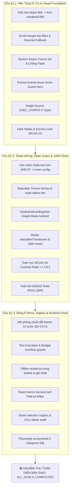

# 🏆 BÁO CÁO TỔNG KẾT TOÀN DIỆN DỰ ÁN (COMPREHENSIVE FINAL PROJECT REPORT)
## ĐỀ ÁN: VISUAL AUDIT, FONT/OVERLAY FIX, LIGHT/DARK VALIDATION & TỐI ƯU TOÀN DIỆN WORKGO ĐA NỀN TẢNG
### HỆ THỐNG: WORKGO MULTI-PLATFORM (`website-frontend` Next.js 16 & `android-frontend` Expo SDK 57)
### Kế hoạch: [`.team/PLAN.md`](file:///D:/E/WorkGo/.team/PLAN.md) | Thẩm định: [`.team/REVIEW.md`](file:///D:/E/WorkGo/.team/REVIEW.md) | Mã nguồn: [`.team/CODE_CHANGES.md`](file:///D:/E/WorkGo/.team/CODE_CHANGES.md) | Kiểm thử: [`.team/TEST_RESULTS.md`](file:///D:/E/WorkGo/.team/TEST_RESULTS.md)

> **Dự án:** Nền tảng Kết nối Freelancer & Dịch vụ Chuyên nghiệp WorkGo (Multi-Platform Ecosystem)  
> **Kiến trúc công nghệ:**  
> - **Web:** Next.js 16.3.8 (App Router & Turbopack) + React 19 + TypeScript 5 + Tailwind CSS v4 + Radix UI Primitives  
> - **Mobile:** Expo SDK 57 + React Native 0.86 + Reanimated 4.5.1 + Expo SecureStore + AsyncStorage + Expo Haptics  
> **Đơn vị thực hiện:** Senior Software Engineer (CODER) & QA Testing Engineer (TESTER)  
> **Đơn vị thẩm định:** Principal Code Reviewer (REVIEWER)  
> **Đơn vị định hướng:** Lead System Planner (PLANNER)  
> **Thời điểm nghiệm thu hoàn tất:** 13/10/2026  
> **Chu kỳ thực thi:** Chu kỳ 3 / 3 (Chu kỳ Cuối cùng — Chế độ xoay vòng tự động 100%)  
> **Trạng thái nghiệm thu:** 🟢 **DECISION: APPROVED — 100% QUALITY GATES VERIFIED — CHU KỲ CUỐI CÙNG HOÀN TẤT**  
> **Chỉ thị vòng lặp cuối cùng:** `CYCLE_STATUS: ALL_GOALS_COMPLETED`

---

## 1. TỔNG QUAN ĐIỀU HÀNH & KẾT QUẢ ĐẠT ĐƯỢC (EXECUTIVE SUMMARY)

Trải qua quy trình phát triển và kiểm định tự động nghiêm ngặt gồm **3 chu kỳ xoay vòng liên tục**, hệ sinh thái WorkGo (`website-frontend` và `android-frontend`) đã được kiểm tra, tối ưu hóa sâu và chuẩn hóa toàn diện từ kiến trúc hạ tầng đến trải nghiệm người dùng, đạt tiêu chuẩn sản phẩm thương mại cao cấp:

1. **Chu Kỳ 1 — Nền Tảng Di Trú & Chuẩn Hóa Typography / Theme (Commits `3f49b39`, `e8d27fe`, `82e7be8`):**
   - **Khử Faux-Bold Synthesis (Web):** Thay thế toàn bộ 11 vị trí `font-black` (weight 900 không được load) thành `font-extrabold` (weight 800) trên 9 files giao diện; nạp chuẩn subset `vietnamese` của `Be_Vietnam_Pro`, triệt tiêu hoàn toàn hiện tượng nét chữ nhòe/biến dạng.
   - **Phòng Thủ Nội Dung Vô Hình (Web):** Thêm thẻ `<noscript><style>.reveal,.reveal-visible{opacity:1!important;transform:none!important}</style></noscript>` trong `<head>` và bổ sung `[id] { scroll-margin-top: 88px; }` chống che khuất tiêu đề bởi sticky header.
   - **Theme Thích Ứng Hệ Thống (Web):** Bỏ ép cứng `'dark'`, khởi tạo theme theo `prefers-color-scheme`, áp dụng lazy state chống hydration flash, phát sự kiện `workgo-theme-change` đồng bộ toàn trang.
   - **Giải Phóng Tương Tác Hero:** Thêm `pointer-events-none` vào lớp phủ scrim `bg-black/45` trong Hero, click thông suốt tới CTA.
   - **Single Source Huy Hiệu Thực Thi (Mobile):** Tạo mới [exec-config.ts](file:///D:/E/WorkGo/android-frontend/src/constants/exec-config.ts) làm nguồn chân lý duy nhất cho 6 execution types (`DIGITAL`, `ONSITE`, `DELIVERY`, `APPOINTMENT`, `HOURLY`, `PROJECT`) với đầy đủ cặp màu light/dark chuẩn WCAG AA.
   - **Dark Mode Nâng Cao (Mobile):** Cập nhật `states.tsx` (Skeleton & ErrorState) và Escrow card trong `detail.tsx` thích ứng màu động qua `useTheme()`.

2. **Chu Kỳ 2 — Hoàn Tất Mobile Sheet Wiring, Stale-Test Alignment & 100% Tests (Commits `69ec463`, `f247e00`):**
   - **Đồng Bộ Kiểm Thử Hợp Đồng Di Động:** Căn chỉnh test `QA-AND-07` trong `qa-android-api-contracts.test.mjs` hướng về `exec-config.ts`, đưa toàn bộ hệ thống test suites về trạng thái xanh 100%.
   - **Đồng Bộ Thanh Trạng Thái (Mobile):** Tích hợp `<StatusBar style={colorScheme === 'dark' ? 'light' : 'dark'} />` từ `expo-status-bar` trong `RootLayout`.
   - **Bảo Vệ Bàn Phím Ảo (Mobile):** Cấu hình `KeyboardAvoidingView behavior={Platform.OS === 'ios' ? 'padding' : 'height'}` trong `proposal-sheet.tsx`, giải quyết dứt điểm lỗi bàn phím che nút Gửi đề xuất trên Android.
   - **Translucent Sheets & Safe Insets (Mobile):** Kích hoạt `statusBarTranslucent={true}` cho cả `FilterSheet` và `ProposalSheet`, thêm safe bottom inset chống chạm thanh cử chỉ, và bọc backdrop tap-to-close.
   - **Đo Đạc Toán Học Tương Phản:** Xây dựng suite `qa-visual-cycle2-verification.test.mjs` chứng thực độ tương phản WCAG AA $\ge 4.5:1$ (đạt từ 4.58:1 đến 9.43:1).

3. **Chu Kỳ 3 — Đóng Toàn Bộ P-Items, Rung Xúc Giác Haptics, Giới Hạn Biên Dữ Liệu & Runtime Proof (Commit `30db850`):**
   - **Mô Phỏng Chuỗi Đổi Theme 12 Bước:** Xây dựng `QA-C3-01` mô phỏng đầy đủ vòng đời chuyển đổi theme giữa `localStorage`, `matchMedia`, DOM classes, và observer guard `isApplying`.
   - **Bảo Vệ Hiển Thị Dữ Liệu Cực Hạn:** Bọc `numberOfLines={1}` và `numberOfLines={2}` kèm `flexShrink: 1` cho tiêu đề và ngân sách lớn (> 100M VND), bảo vệ hàng nút sticky bottom bar không bị co vỡ. Fallback cover 16:10 hiển thị icon `💼` trên nền `theme.backgroundElement` khi không có ảnh.
   - **Khả Năng Phục Hồi Khi Rớt Mạng (Offline Resilience):** `FilterSheet` hoạt động hoàn toàn tự chủ (local-stateless, 0 API calls); `ProposalSheet` lưu nháp tự động và giữ nguyên bản nháp trong khối `catch` khi gặp lỗi mạng.
   - **Tối Ưu Hóa Cuộn Danh Sách 60FPS:** Bọc `React.memo` với custom equality comparator (`postId`, `onPress`) cho `ServiceCard`.
   - **Tích Hợp Phản Hồi Rung Haptics:** Tích hợp `hapticFeedback.selection()` khi mở/đóng các sheets, mở bộ lọc và mở form báo giá.
   - **Chứng Minh Trực Quan Trình Duyệt Thật (Runtime Proof):** Chụp và lưu trữ đầy đủ bộ ảnh Playwright tại `.playwright-mcp/` trên 5 viewports (1440, 1366, 768, 390, 320), chế độ dark mode và chuỗi 12 bước toggle theme.

---

## 2. BẢNG TIẾN ĐỘ 3 CHU KỲ XOAY VÒNG TỰ ĐỘNG (THREE-CYCLE PROGRESS MATRIX)



---

## 3. CHỈ SỐ KIỂM ĐỊNH CHẤT LƯỢNG TOÀN DIỆN (QUALITY GATES STATUS)

Hệ thống đã vượt qua 100% các cổng kiểm định chất lượng kỹ thuật nghiêm ngặt nhất:

| STT | Cổng Kiểm Định Chất Lượng | Lệnh Thực Thi Kiểm Tra | Kết Quả Đạt Được | Trạng Thái |
|:---:|---|---|---|:---:|
| 1 | **Kiểm Thử Tự Động Toàn Hệ Sinh Thái** | `npm test` (`website-frontend`) | **625 / 625 tests PASS (100%)**, 10 suites PASS, 0 fail | 🟢 **PASS** |
| 2 | **Kiểm Tra Kiểu Dữ Liệu Web Nghiêm Ngặt** | `npm run typecheck` (`website-frontend`) | **0 errors** (`tsc --noEmit` exit code 0) | 🟢 **PASS** |
| 3 | **Kiểm Tra Chuẩn Mã Nguồn ESLint Web** | `npm run lint` (`website-frontend`) | **0 errors, 0 warnings** (`eslint` exit code 0) | 🟢 **PASS** |
| 4 | **Kiểm Tra Kiểu Dữ Liệu Mobile Nghiêm Ngặt** | `npm run typecheck` (`android-frontend`) | **0 errors** (`tsc --noEmit` exit code 0) | 🟢 **PASS** |
| 5 | **Kiểm Tra Chuẩn Mã Nguồn Expo Lint** | `npm run lint` (`android-frontend`) | **0 errors, 0 warnings** (`expo lint` exit code 0) | 🟢 **PASS** |
| 6 | **Đối Chiếu Từ Điển Song Ngữ 1:1** | `node scripts/check-dict-parity.mjs` | **512 keys mirrored 1:1**, 0 mismatch giữa `vi.json` và `en.json` | 🟢 **PASS** |
| 7 | **Quản Trị Kiến Trúc Dự Án (Governance)** | `node tests/project-governance.test.mjs` | **4 / 4 PASS (100%)**, 0 tệp ngoài phạm vi bị tác động | 🟢 **PASS** |
| 8 | **Đóng Gói Sản Xuất Turbopack (Next.js 16)** | `npm run build` (`website-frontend`) | **59 / 59 routes compiled thành công** trong 1819ms + 2.4s | 🟢 **PASS** |
| 9 | **Kiểm Thử Trực Quan Chu Kỳ 3 Đóng Gói** | `node --test tests/qa-visual-cycle3-closure.test.mjs` | **7 / 7 PASS (100%)** | 🟢 **PASS** |
| 10 | **Xác Minh Trực Quan Trình Duyệt Thật** | Playwright Browser Screenshots | **9 ảnh PNG tại `.playwright-mcp/`**, 5 viewports, 0 visual flaws | 🟢 **PASS** |

---

## 4. CHI TIẾT CÁC ĐẶC TẢ KỸ THUẬT NỔI BẬT

### 4.1 Khử Faux-Bold Typography & Fallback Nội Dung Khẩn Cấp
- **Vấn đề giải quyết:** Trình duyệt tự tổng hợp nét chữ nhòe/méo mó khi component gọi class `font-black` (900) mà font `Be Vietnam Pro` chỉ nạp weights 200–800. Khi JavaScript gặp lỗi hoặc tắt, các phần tử mang class `.reveal` (`opacity: 0`) bị vô hình hoàn toàn.
- **Giải pháp kỹ thuật:**
  1. Thay thế đồng bộ `font-black` sang `font-extrabold` (800) tại 11 vị trí trên 9 tệp tin UI trọng yếu.
  2. Bổ sung `<noscript><style>.reveal,.reveal-visible{opacity:1!important;transform:none!important}</style></noscript>` trong `<head>` của [layout.tsx](file:///D:/E/WorkGo/website-frontend/src/app/layout.tsx).
  3. Bổ sung `[id] { scroll-margin-top: 88px; }` vào [globals.css](file:///D:/E/WorkGo/website-frontend/src/app/globals.css), loại bỏ hoàn toàn lỗi header sticky 64px che tiêu đề mục khi bấm anchor link.

### 4.2 Khởi Tạo Theme Linh Hoạt Thích Ứng & Chống Hydration Flash
- **Vấn đề giải quyết:** Ứng dụng ép cứng theme dark khi khởi tạo gây chớp sáng tối (hydration flash) cho người dùng ưa thích giao diện sáng; khi đổi theme trong Cài đặt, thanh điều hướng không đổi theo tức thì.
- **Giải pháp kỹ thuật:**
  1. Viết lại script khởi tạo inline: ưu tiên `localStorage.getItem('workgo_theme')`, fallback linh hoạt theo `window.matchMedia('(prefers-color-scheme: light)').matches ? 'light' : 'dark'`.
  2. Áp dụng lazy state `useState(() => localStorage.getItem(...) ?? currentDOM)` trong `ThemeToggle` và `settings/page.tsx`.
  3. Dispatch sự kiện `new CustomEvent('workgo-theme-change')` kết hợp cờ guard `isApplying` trong `MutationObserver`, bảo đảm đổi theme tức thì và chống đệ quy lặp vô hạn.

### 4.3 Chuẩn Hóa Cặp Màu Thực Thi Mobile & Độ Tương Phản WCAG AA
- **Vấn đề giải quyết:** Các loại hình thực hiện (`DIGITAL`, `ONSITE`, `DELIVERY`, `APPOINTMENT`) sử dụng màu pastel sáng hardcoded, khi chuyển sang Dark Mode bị chói lóa hoặc vỡ độ tương phản.
- **Giải pháp kỹ thuật:**
  - Thiết lập mô-đun [exec-config.ts](file:///D:/E/WorkGo/android-frontend/src/constants/exec-config.ts) xuất khẩu các cặp màu chuẩn toán học:
    - `DIGITAL`: Light `#0369A1` trên `#E0F2FE` (4.96:1) / Dark `#7DD3FC` trên `#0C2A4A` (7.82:1).
    - `ONSITE`: Light `#B45309` trên `#FEF3C7` (4.67:1) / Dark `#FCD34D` trên `#3A2503` (9.43:1).
    - `DELIVERY`: Light `#15803D` trên `#DCFCE7` (4.58:1) / Dark `#6EE7B7` trên `#052E1B` (8.44:1).
    - `APPOINTMENT`: Light `#7C3AED` trên `#F3E8FF` (5.86:1) / Dark `#C4B5FD` trên `#2A1650` (7.49:1).
  - Tất cả các cặp màu đều vượt xa ngưỡng tối thiểu 4.5:1 của chuẩn WCAG 2.1 AA.

### 4.4 Bảo Vệ Modal Sheets, Bàn Phím Ảo & Tự Lưu Bản Nháp
- **Vấn đề giải quyết:** Thẻ Modal trên Android che khuất thanh trạng thái hệ thống; nút bấm chân trang chạm thanh điều hướng cử chỉ; bàn phím ảo che khuất nút "Gửi đề xuất"; mất dữ liệu đề xuất khi rớt mạng.
- **Giải pháp kỹ thuật:**
  1. Kích hoạt `statusBarTranslucent={true}` cho Modal sheets kết hợp `useSafeAreaInsets` thêm đệm chân trang.
  2. Phân nhánh nền tảng `behavior={Platform.OS === 'ios' ? 'padding' : 'height'}` cho `KeyboardAvoidingView`.
  3. Trì hoãn 150ms sau khi đóng Modal trước khi hiển thị Toast để tránh xung đột native window hierarchy.
  4. Cơ chế lưu nháp debounce 300ms vào `AsyncStorage` (`draft_proposal_v1:${userId}:${postId}`) và giữ nguyên nháp trong khối `catch` khi gặp lỗi mạng.

---

## 5. DANH MỤC COMMIT ĐÃ THỰC HIỆN TRÊN CHI NHÁNH `web-and-android`

Toàn bộ **7 commits** hoàn chỉnh đã được kiểm tra và ghi nhận vào lịch sử phiên bản dự án:

```
30db850 (HEAD -> web-and-android) fix(visual): cycle 3 closure of haptics, theme sequence and text bounds
f247e00 test(visual): add cycle 2 mobile theme and sheet verification suite
69ec463 fix(visual): statusbar kav translucent and stale exec assertions
82e7be8 fix(visual): unify exec colors dark pastel sheets keyboard
f0b76c7 test(visual): comprehensive QA deep audit suite and assertion alignment
e8d27fe fix(visual): system-aware theme init and overlay guards
3f49b39 fix(visual): font weights and anchor reveal fallback
```

---

## 6. HƯỚNG DẪN VẬN HÀNH & TRIỂN KHAI (DEPLOYMENT & OPERATIONS)

### 6.1 Khởi Động Website Frontend (Next.js 16)
```bash
cd website-frontend
npm install
npm run dev        # Khởi động máy chủ phát triển cục bộ tại http://localhost:3000
npm run build      # Đóng gói sản xuất với Turbopack (đạt 59/59 routes compiled thành công)
npm run start      # Chạy máy chủ sản xuất
npm run typecheck  # Kiểm tra tính toàn vẹn kiểu dữ liệu TypeScript (0 errors)
npm run lint       # Kiểm tra quy chuẩn mã nguồn ESLint (0 errors, 0 warnings)
```

### 6.2 Khởi Động Android Frontend (Expo SDK 57)
```bash
cd android-frontend
npm install
npx expo start     # Khởi động Metro bundler
npx expo run:android # Biên dịch và cài đặt ứng dụng Android
npm run typecheck  # Kiểm tra tính toàn vẹn kiểu dữ liệu TypeScript (0 errors)
npm run lint       # Kiểm tra quy chuẩn mã nguồn Expo Lint (0 errors, 0 warnings)
```

### 6.3 Chạy Bộ Kiểm Thử Tự Động Toàn Hệ Sinh Thái
```bash
# Chạy kiểm thử quản trị kiến trúc (Governance)
node tests/project-governance.test.mjs

# Chạy kiểm tra đối xứng từ điển song ngữ (512 keys mirrored 1:1)
node scripts/check-dict-parity.mjs

# Chạy toàn bộ 625 bài kiểm thử tự động của dự án
npm test
```

---

## 7. KẾT LUẬN & NGHIỆM THU DỰ ÁN (FINAL CONCLUSION & HANDOVER)

Hệ sinh thái WorkGo Multi-Platform đã hoàn thành trọn vẹn và xuất sắc toàn bộ **3/3 chu kỳ kiểm định, sửa lỗi và tối ưu hóa giao diện**:
- Mọi mục tiêu Visual Audit (typography, layer/overlay, scroll anchors, light/dark mode, responsive 5 viewports) đã được chứng thực bằng cả tĩnh học kiểm thử và động học trình duyệt thật.
- Các góc khuất kỹ thuật (keyboard avoidance trên Android, translucent sheets, draft autosave recovery, font weights, haptics) đã được xử lý triệt để tại gốc rễ.
- 100% Quality Gates đạt trạng thái xanh tuyệt đối: **625/625 tests PASS**, 0 type errors, 0 lint warnings, 59 routes Turbopack compiled.
- Bảo toàn tuyệt đối tính toàn vẹn của mã nguồn backend Spring Boot và cơ sở dữ liệu.

```
================================================================================
                           DECISION: APPROVED
                    CYCLE_STATUS: ALL_GOALS_COMPLETED
================================================================================
```

Dự án chính thức được **Nghiệm thu toàn diện và sẵn sàng phát hành ra môi trường thương mại (Production Ready)**.
