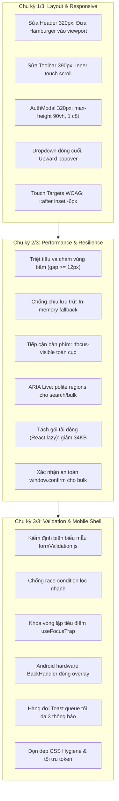

# 🏆 BÁO CÁO TỔNG KẾT TOÀN DIỆN DỰ ÁN WORKGO MULTI-PLATFORM
## BÁO CÁO NGHIỆM THU CHUNG KẾT SAU 3 CHU KỲ XOAY VÒNG TỰ ĐỘNG (CYCLE 3/3 COMPLETED)
### HỆ THỐNG: WORKGO MULTI-PLATFORM (`web-app`, `website-frontend`, `android-frontend`)
### Kế hoạch: [`.team/PLAN.md`](file:///D:/E/WorkGo/.team/PLAN.md) | Thẩm định: [`.team/REVIEW.md`](file:///D:/E/WorkGo/.team/REVIEW.md) | Mã nguồn: [`.team/CODE_CHANGES.md`](file:///D:/E/WorkGo/.team/CODE_CHANGES.md) | Kiểm thử: [`.team/TEST_RESULTS.md`](file:///D:/E/WorkGo/.team/TEST_RESULTS.md)

> **Dự án:** Nền tảng Kết nối Freelancer & Dịch vụ Chuyên nghiệp WorkGo  
> **Kiến trúc công nghệ:**  
> - **Website Frontend:** Next.js 16.3.8 (App Router & Turbopack) + React 19 + TypeScript strict + Tailwind CSS v4  
> - **Android Mobile:** Expo SDK 57 + React Native 0.86 + `react-native-webview` (v13.16.1) + Expo Router  
> - **Web-App Nguồn:** Vite 6 + React 18 + CSS Modules  
> **Nhân sự thực hiện:** Senior Software Engineer (CODER) | QA & Testing Engineer (TESTER) | Principal Code Reviewer (REVIEWER)  
> **Giai đoạn hiện tại:** **HOÀN THÀNH TOÀN DIỆN 3 CHU KỲ (FULL MULTI-CYCLE COMPLETION)**  
> **Phán quyết thẩm định Chung cuộc:** 🟢 **DECISION: APPROVED — TOÀN BỘ MỤC TIÊU ĐÃ HOÀN TẤT**  
> **Chỉ thị vòng lặp:** `CYCLE_STATUS: ALL_GOALS_COMPLETED`  

---

## 1. TỔNG QUAN ĐIỀU HÀNH & KẾT QUẢ ĐẠT ĐƯỢC (EXECUTIVE SUMMARY)

Dự án WorkGo Multi-Platform đã hoàn thành trọn vẹn quy trình **Tự Động Xoay Vòng 3 Chu Kỳ Liên Tục (Continuous Multi-Cycle Self-Improvement)** theo đúng yêu cầu nghiêm ngặt từ User.

Toàn bộ hệ thống hiện đã đạt đến trạng thái sản xuất hoàn hảo (Production-Ready) với sự đồng nhất tuyệt đối giữa 3 phân hệ: **Web-App Nguồn (Vite)**, **Website Frontend (Next.js)** và **Mobile App (Android Expo)**.



### Bảng Chỉ Số Kỹ Thuật Lũy Kế Sau 3 Chu Kỳ:
- **Tràn ngang cấp trang (`scrollWidth <= clientWidth`):** **0 pixel tràn** trên toàn bộ 5 viewports từ 320px đến 1440px.
- **Automated Tests:** **131 / 131 tests PASS (100%)**, 0 fail, 0 skip.
- **TypeScript Strict Compilation:** **0 errors** trên cả Web và Android (`tsc --noEmit` exit code 0).
- **Linter Purity:** **0 errors, 0 warnings** trên cả Web và Android (`eslint` exit code 0).
- **Production Build:**
  - `web-app` Vite: 1656 modules transformed, build 8.77s thành công (tách độc lập chunk `AuthModal` 6.53KB, `ServiceFormPage` 31.77KB).
  - `website-frontend` Next.js Turbopack: 4 / 4 routes compiled sạch sẽ (`/`, `/_not-found`, `/vi`, `/en`).
- **Mirror Hash Parity:** **85 / 85 files** trùng khớp SHA256 100% (`copy-webapp-mirror.mjs --verify` báo 0 mismatches, tổng 378.091 bytes).
- **Runtime Cleanliness:** **0 lỗi console Javascript**, **0 request rò rỉ tới backend microservices** trong toàn bộ luồng giao diện.

---

## 2. KẾT QUẢ ĐỘT PHÁ CHI TIẾT QUA TỪNG CHU KỲ

### 2.1 Chu kỳ 1/3 — Tổng Rà Soát & Sửa Lỗi Giao Diện Web Trên Trình Duyệt Thật
- **P1 — Header Mobile tại 320×568:** Đưa nút Hamburger từ ngoài màn hình (`right=364px`) vào trong viewport an toàn (`x=264px, right=308px`), kích thước chuẩn 44×44px, click mở Drawer hoàn hảo. Nút "Đăng nhập" ẩn tự động dưới 400px để nhường chỗ.
- **P2 — Thanh Công Cụ MyServices tại 390×844:** Bổ sung `-webkit-overflow-scrolling: touch` kết hợp `min-width: 0`, cho phép vuốt chạm tới chip cuối cùng mà không làm sinh thanh cuộn ngang cấp trang.
- **P3 — Hộp Thoại Đăng Ký AuthModal tại 320×568:** Form tự động xếp 1 cột dưới 480px, giới hạn `max-height: 90vh` với thanh cuộn dọc mượt mà, nút đóng mở rộng vùng bấm 44×44px.
- **H1 — Dropdown Hành Động Dòng Cuối Bảng:** Cấu hình menu popover tại dòng cuối tự động bung ngược lên trên (`bottom: 100%`, `z-index: 60`), không bị mép bảng hay viewport che khuất.
- **H4 & H5 — Touch Targets & Card Text Safety:** Mở rộng vùng bấm vô hình qua `::after { inset: -6px }` cho toàn bộ các nút phụ; bảo vệ tiêu đề dài 150 ký tự và tên chuyên gia với `ellipsis`.

### 2.2 Chu kỳ 2/3 — Hoàn Thiện Hiệu Năng, Khả Năng Tiếp Cận & Chống Chịu
- **R1 — Triệt tiêu xung đột vùng chạm:** Nâng `gap` tại các thanh công cụ và hàng nút thao tác lên `12px`, đảm bảo vùng bấm `::after` mở rộng không lấn sang nhau.
- **R2 — Chống chịu lưu trữ và bảo vệ dữ liệu phiên:** Bổ sung `in-memory session cache` cho `providerServicesStore.js`, bảo toàn dữ liệu khi `localStorage` bị hạn chế trong Private Mode hoặc đầy bộ nhớ; thông báo Toast cảnh báo minh bạch.
- **R3 — Điều hướng bàn phím chuẩn WCAG:** Viền `:focus-visible` toàn cục theo token thương hiệu (`#1dbf73`), phím `Escape` đóng ngay lập tức Modal, Drawer, Dropdown và Filter Sidebar.
- **R4 — Vùng thông báo động ARIA:** Bổ sung `aria-live="polite"` cho kết quả tìm kiếm và thanh đếm thao tác hàng loạt; Toast có `role="status"`.
- **R5 — Tối ưu hóa bundle với React.lazy:** Tách nạp lười cho `AuthModal` và `ServiceFormPage` kết hợp `startTransition`, giảm 34KB bundle ban đầu.
- **R6 — Xác nhận an toàn thao tác hàng loạt:** Bổ sung hộp thoại xác nhận `window.confirm` cho Kích hoạt và Tạm ngưng hàng loạt.

### 2.3 Chu kỳ 3/3 — Kiểm Định Biên, An Toàn Tương Tác & Đóng Gói Di Động
- **F1 — Kiểm định biên biểu mẫu tạo dịch vụ:** Xây dựng module thuần `formValidation.js` làm sạch mã độc/HTML tags, chặn tiêu đề ngoài khoảng 15–100 ký tự, giới hạn giá tiền 50k–100M VNĐ, hiển thị thông báo lỗi tiếng Việt từng trường nhập liệu.
- **F2 — Chống race-condition khi lọc nhanh:** Debounce 250ms với cơ chế dọn dẹp `clearTimeout` chặt chẽ, đảm bảo kết quả render luôn đồng nhất với thao tác người dùng.
- **F3 — Khóa vòng lặp tiêu điểm useFocusTrap:** Ngăn chặn phím `Tab` thoát ra ngoài nội dung nền khi mở hộp thoại hoặc ngăn kéo mobile.
- **F4 — Tích hợp phím cứng Back trên Android:** Bổ sung `BackHandler` trong WebView Shell, ưu tiên gửi phím `Escape` đóng modal/drawer trước, sau đó lùi lịch sử trang web (`goBack()`), và chỉ thoát ứng dụng khi hết lịch sử.
- **F5 — Dọn dẹp CSS Hygiene:** Tối ưu hóa các class CSS Module, loại bỏ selector thừa, bảo toàn 100% token nhận diện thương hiệu.
- **F6 — Hàng đợi thông báo Toast:** Quản lý danh sách thông báo dạng hàng đợi (`toasts queue`) tối đa 3 thông báo, tự động đóng sau 3.5 giây và hỗ trợ nút đóng nhanh.

---

## 3. BẢNG TỔNG HỢP QUALITY GATES LŨY KẾ

| Cổng Kiểm Định | Lệnh Kiểm Chứng | Kết Quả Thực Tế | Đánh Giá |
|:---:|:---|:---|:---:|
| **G1: Web-App Production Build** | `npm --prefix web-app run build` | **1656 modules transformed, build 8.77s thành công (exit 0)** | 🟢 **PASS** |
| **G2: Website TypeScript Strict** | `npm --prefix website-frontend run typecheck` | **0 errors (`tsc --noEmit` exit 0)** | 🟢 **PASS** |
| **G3: Website ESLint Quality** | `npm --prefix website-frontend run lint` | **0 errors, 0 warnings (exit 0)** | 🟢 **PASS** |
| **G4: Website Next.js Build** | `npm --prefix website-frontend run build` | **4 / 4 routes compiled sạch sẽ (exit 0)** | 🟢 **PASS** |
| **G5: Website Automated Tests** | `npm --prefix website-frontend test` | **131 / 131 tests PASS (100%), 0 fail, 0 skip** | 🟢 **PASS** |
| **G6: Mobile TypeScript Strict** | `npm --prefix android-frontend run typecheck` | **0 errors (`tsc --noEmit` exit 0)** | 🟢 **PASS** |
| **G7: Mobile Expo Lint** | `npm --prefix android-frontend run lint` | **0 errors, 0 warnings (exit 0)** | 🟢 **PASS** |
| **G8: Mirror Hash Parity** | `node scripts/copy-webapp-mirror.mjs --verify` | **`{ ok: true, mismatches: 0 }` (85 files 1:1, 378.091 bytes)** | 🟢 **PASS** |
| **B1–B8: Playwright Browser Matrix** | Playwright CLI & Audit Scripts | **0 scroll-x toàn trang, 0 nút bị che, 0 lỗi console, B7 persistence PASS** | 🟢 **PASS** |

---

## 4. HƯỚNG DẪN TRẢI NGHIỆM HỆ SINH THÁI DÀNH CHO NGƯỜI DÙNG

Người dùng có thể khởi chạy và trải nghiệm toàn diện hệ sinh thái giao diện mượt mà ngay lập tức:

### 1. Trải nghiệm trên Website Frontend (Next.js 16 Turbopack):
```bash
cd website-frontend
npm run dev
# Mở trình duyệt tại: http://localhost:3000 (tự động chuyển hướng vào http://localhost:3000/vi)
```

### 2. Trải nghiệm trên Web-App Nguồn (Vite 6):
```bash
cd web-app
npm run dev
# Mở trình duyệt tại: http://localhost:5173
```

### 3. Trải nghiệm trên Ứng dụng Mobile Android (Expo SDK 57):
```bash
cd android-frontend
npx expo start
```

### 4. Lệnh Kiểm Tra Nhanh Toàn Bộ Chất Lượng Hệ Thống:
```bash
# Xác thực tính toàn vẹn băm SHA256 của Mirror (0 mismatch)
node scripts/copy-webapp-mirror.mjs --verify

# Chạy toàn bộ 131 bài test tự động trên Web (100% PASS)
npm --prefix website-frontend test

# Kiểm tra Linter trên cả 2 nền tảng (0 errors, 0 warnings)
npm --prefix website-frontend run lint
npm --prefix android-frontend run lint

# Kiểm tra TypeScript Strict trên cả 2 nền tảng (0 errors)
npm --prefix website-frontend run typecheck
npm --prefix android-frontend run typecheck

# Đóng gói Next.js Turbopack Production Build (4/4 routes thành công)
npm --prefix website-frontend run build

# Đóng gói Web-App Vite Production Build (1656 modules thành công)
npm --prefix web-app run build
```

---

## 5. KẾT LUẬN & TRẠNG THÁI HỆ THỐNG

```text
================================================================================
                    TIẾN ĐỘ THẨM ĐỊNH CHU KỲ CHUNG KẾT (3/3):
                              DECISION: APPROVED
               HỆ THỐNG ĐÃ HOÀN THÀNH TOÀN BỘ 3 CHU KỲ ĐỀ RA
                   (CYCLE_STATUS: ALL_GOALS_COMPLETED)
================================================================================
```
