# 🏆 BÁO CÁO TIẾN ĐỘ DỰ ÁN WORKGO MULTI-PLATFORM
## TIẾN TRÌNH THỰC HIỆN CHU KỲ 1/3 (HỆ THỐNG TỰ ĐỘNG XOAY VÒNG 3 CHU KỲ)
### HỆ THỐNG: WORKGO MULTI-PLATFORM (`web-app`, `website-frontend`, `android-frontend`)
### Tài liệu liên quan: [`.team/PLAN.md`](file:///D:/E/WorkGo/.team/PLAN.md) | [`.team/CODE_CHANGES.md`](file:///D:/E/WorkGo/.team/CODE_CHANGES.md) | [`.team/TEST_RESULTS.md`](file:///D:/E/WorkGo/.team/TEST_RESULTS.md) | [`.team/REVIEW.md`](file:///D:/E/WorkGo/.team/REVIEW.md)

> **Dự án:** Nền tảng Kết nối Freelancer & Dịch vụ Chuyên nghiệp WorkGo  
> **Kiến trúc công nghệ:**  
> - **Website Frontend:** Next.js 16.3.8 (App Router & Turbopack) + React 19 + TypeScript strict + Tailwind CSS v4  
> - **Web-App Nguồn:** Vite 6 + React 18 + CSS Modules  
> - **Android Mobile:** Expo SDK 57 + React Native 0.86 + `react-native-webview` (v13.16.1) + Expo Router  
> **Nhân sự thực hiện:** Senior Software Engineer (CODER) | QA & Testing Engineer (TESTER) | Principal Code Reviewer (REVIEWER)  
> **Trạng thái tiến độ:** 🟢 **CHU KỲ 1/3 HOÀN THÀNH — DECISION: APPROVED & TIẾP TỤC CHU KỲ 2/3**  
> **Chỉ thị chu kỳ trung gian:** `CYCLE_STATUS: CONTINUE_NEXT_CYCLE`  

---

## 1. TỔNG QUAN ĐIỀU HÀNH & KẾT QUẢ ĐẠT ĐƯỢC TỚI HẾT CHU KỲ 1/3

Hệ thống đang vận hành theo cơ chế **Tự Động Xoay Vòng 3 Chu Kỳ Liên Tục (Continuous Multi-Cycle Self-Improvement)** theo đúng quy tắc tự động 100% của User. Hết Chu kỳ 1/3, toàn bộ các mục tiêu trọng tâm về sửa lỗi giao diện, bảo vệ cấu trúc Shell Bridge và mở rộng hệ thống kiểm thử tự động đã hoàn thành xuất sắc và được thẩm định đạt chuẩn:

```mermaid
flowchart LR
    subgraph C1["Chu Kỳ 1/3: Sửa Lỗi Giao Diện & Hạ Tầng (HOÀN THÀNH)"]
        direction TB
        C1A["Sửa B1: TrungSubNav cố định, z-index 990"]
        C1B["Sửa B2: Giải phóng 15 trang khỏi co 650px"]
        C1C["Sửa B3: Nút tìm kiếm mobile gọn gàng 346x52"]
        C1D["Sửa B4: Header chống tràn 900-1280px"]
        C1E["Sửa B5: Banner offline bù trừ động top-stack"]
        C1F["218/218 Tests Xanh + 7 Viewports Sweep PASS"]
    end

    subgraph C2["Chu Kỳ 2/3: Nâng Cao Trải Nghiệm & Tối Ưu (TIẾP THEO)"]
        direction TB
        C2A["Chỉ báo cuộn & phím tắt cho TrungSubNav"]
        C2B["Inline Validation on Blur cho các Form"]
        C2C["Tối ưu hóa ResizeObserver qua rAF"]
        C2D["Kiểm thử biên chuyển đổi Route Offline"]
        C2E["Quick-select danh sách ngân hàng Việt Nam"]
    end

    subgraph C3["Chu Kỳ 3/3: Kiểm Thử Cực Hạn & Niêm Phong (CHUNG CUỘC)"]
        direction TB
        C3A["Stress test tải dữ liệu & kết nối mạng yếu"]
        C3B["Rà soát toàn diện mã nguồn sạch Zero Noise"]
        C3C["Nghiệm thu toàn diện 100% Quality Gates"]
        C3D["Niêm phong chung cuộc ALL_GOALS_COMPLETED"]
    end

    C1 --> C2 --> C3
```



---

## 2. BẢNG MASTER QUALITY GATES TỔNG THỂ (G1–G8 & SWEEP ĐẠT 100%)

Tất cả các cổng chất lượng kỹ thuật độc lập tại thời điểm kết thúc Chu kỳ 1/3 đều đạt trạng thái xanh tuyệt đối:

| Cổng Kiểm Định (Quality Gate) | Lệnh Thực Thi Kiểm Chứng | Kết Quả Thực Tế Đạt Được | Trạng Thái |
|:---:|---|---|:---:|
| **G1: Website TypeScript Strict** | `npm --prefix website-frontend run typecheck` | **0 errors (`tsc --noEmit` exit 0)** | 🟢 **PASS** |
| **G2: Website ESLint Quality** | `npm --prefix website-frontend run lint` | **0 errors, 0 warnings (exit 0)** | 🟢 **PASS** |
| **G3: Website Next.js Build** | `npm --prefix website-frontend run build` | **Next.js Turbopack biên dịch thành công 4 static routes (`/`, `/_not-found`, `/vi`, `/en`)** | 🟢 **PASS** |
| **G4: Automated Full Test Suite** | `npm --prefix website-frontend test` | **218 / 218 tests PASS (100%), 0 fail, 0 skip** | 🟢 **PASS** |
| **G5: Mobile TypeScript & Lint** | `npm --prefix android-frontend run lint; npm --prefix android-frontend run typecheck` | **Expo lint & TypeScript strict exit 0 (0 errors, 0 warnings)** | 🟢 **PASS** |
| **G6: WebApp Mirror Parity** | `node scripts/copy-webapp-mirror.mjs --verify` | **`{ ok: true, mismatches: 0 }` (85 files 1:1, 380.949 bytes)** | 🟢 **PASS** |
| **G7: Excel Data Integrity** | `git status --porcelain docs/` | **Hoàn toàn sạch sẽ, không có bất kỳ sửa đổi nào (0 bytes modified)** | 🟢 **PASS** |
| **G8: UI Fix Browser Sweep** | `node scripts/qa-ui-fix-sweep.mjs` | **7 / 7 viewports PASS (320px -> 1536px), 0 runtime console errors** | 🟢 **PASS** |

---

## 3. THÀNH TỰU ĐẠT ĐƯỢC TRONG CHU KỲ 1/3 (UI FIX CYCLE)

Chu kỳ 1 tập trung giải quyết triệt để 5 khiếm khuyết giao diện nghiêm trọng được phát hiện trên môi trường thực tế:

### 3.1 Khắc phục dứt điểm 5 lỗi giao diện trọng yếu (B1 – B5)
1. **Lỗi B1 — Thanh `TrungSubNav` bị Header che khuất:**
   - **Hiện trạng cũ:** Nằm trong luồng flow thông thường, bị Header cố định (`fixed top: 0, height: 76px, z-index: 1000`) che khuất hoàn toàn, người dùng không thể nhìn thấy hoặc tương tác với 15 liên kết điều hướng.
   - **Giải pháp:** Chuyển `TrungSubNav` sang `position: fixed`, đặt chính xác tại `top: calc(var(--offline-h, 0px) + var(--base-header-height, 76px))`, chiều cao cố định `61px`, `z-index: 990`.
   - **Kết quả đo:** Hit-test bằng `elementFromPoint` trúng chính xác các liên kết của SubNav tại 100% các viewport thử nghiệm.
2. **Lỗi B2 — 15 trang trung-pages bị co về 650px:**
   - **Hiện trạng cũ:** `.appRoot` có bố cục `display: flex; flex-direction: column`. Các trang con có `margin: 0 auto` vô tình hủy bỏ thuộc tính `align-items: stretch` trên trục phụ (cross-axis), khiến nội dung bị co về 650px.
   - **Giải pháp:** Bổ sung lớp bọc `.pageScope` áp dụng `display: flex; flex-direction: column; min-width: 0; flex: 1` và `.offsetScope { padding-top: var(--header-height); }` cho 18 routes cần đệm trên.
   - **Kết quả đo:** Chiều rộng nội dung đạt trọn vẹn `1320px` tại màn hình desktop (1440px / 1536px) và co giãn mượt mà không tràn ngang tại màn hình nhỏ (320px, 390px, 768px, 1024px).
3. **Lỗi B3 — Nút tìm kiếm Hero phình to 332×182px trên mobile:**
   - **Hiện trạng cũ:** Quy tắc `height: 100%` trong layout cột trên màn hình `<= 768px` kéo dãn chiều cao nút bấm bất thường.
   - **Giải pháp:** Bổ sung `@media (max-width: 768px) { .submitBtn { height: auto; } }` trong `SearchBar.module.css`.
   - **Kết quả đo:** Nút tìm kiếm co về kích thước chuẩn `346 × 52px`, nằm gọn gàng bên trong container `350px` tại viewport 390×844.
4. **Lỗi B4 — Header container tràn ngang ở dải 900–1280px:**
   - **Hiện trạng cũ:** Nút "Đăng ký" bị đẩy ra sát mép màn hình, nhãn liên kết điều hướng bị rớt thành 2 dòng khi cuộn trang.
   - **Giải pháp:** Giới hạn Header container `max-width: 1320px`, áp dụng `white-space: nowrap` cho các liên kết, nâng breakpoint chuyển đổi sang menu di động lên `1100px`, ẩn thanh tìm kiếm trên Header ở màn hình dưới `1280px`, và bổ sung `flex-shrink: 0` cho cụm nút thao tác.
   - **Kết quả đo:** `maxRight` đo được luôn nhỏ hơn viewport width (`1000px <= 1024px`, `1256px <= 1280px`, `1356px <= 1440px`), nhãn chữ giữ nguyên 1 dòng duy nhất cao 22.8px.
5. **Lỗi B5 — Banner thông báo ngoại tuyến đè lên Header:**
   - **Hiện trạng cũ:** Khi mất mạng, banner `.offlineBanner` hiển thị ở vị trí sticky top 0 khiến Header và SubNav bị đè lấn khoảng 57px.
   - **Giải pháp:** Tích hợp `ResizeObserver` trong `webapp-shell.tsx` để đo đạc chiều cao thực tế của banner và gán động vào biến CSS `--offline-h`. Header và SubNav sử dụng công thức tính toán `top-stack` tự động trượt xuống tương ứng.
   - **Kết quả đo:** Khi offline, banner cao 56.8px @390px đẩy Header xuống `top: 57px` và SubNav xuống `top: 133px`. Khi kết nối mạng phục hồi, Header trở về `top: 0px` và SubNav về `top: 76px` sạch sẽ.

---

## 4. CHI TIẾT THAY ĐỔI MÃ NGUỒN TRONG CHU KỲ 1/3

Nhật ký kỹ thuật chi tiết tại [`.team/CODE_CHANGES.md`](file:///D:/E/WorkGo/.team/CODE_CHANGES.md). Các tệp thay đổi chính bao gồm:

1. [`web-app/src/components/common/Header/Header.module.css`](file:///D:/E/WorkGo/web-app/src/components/common/Header/Header.module.css):
   - Giới hạn chiều rộng container 1320px, loại bỏ focus mở rộng navSearch, cấu hình breakpoint 1100px / 1280px, xử lý bù trừ `--offline-h`.
2. [`web-app/src/components/common/SearchBar/SearchBar.module.css`](file:///D:/E/WorkGo/web-app/src/components/common/SearchBar/SearchBar.module.css):
   - Thiết lập `height: auto` cho `.submitBtn` trên màn hình di động `<= 768px`.
3. [`website-frontend/src/components/webapp-bridge/webapp-shell.module.css`](file:///D:/E/WorkGo/website-frontend/src/components/webapp-bridge/webapp-shell.module.css):
   - Khai báo hợp đồng biến CSS `--base-header-height`, `--subnav-height`, `--offline-h`, `--top-stack`; thêm các lớp định tuyến `.pageScope`, `.offsetScope`, `.appRootNoHeader`.
4. [`website-frontend/src/components/webapp-bridge/webapp-shell.tsx`](file:///D:/E/WorkGo/website-frontend/src/components/webapp-bridge/webapp-shell.tsx):
   - Lắng nghe `ResizeObserver` trên banner ngoại tuyến, bọc 18 routes trong `offsetScope`, xử lý trạng thái ẩn Header cho `service-form`.
5. [`website-frontend/src/components/trung-pages/_ui/TrungSubNav.module.css`](file:///D:/E/WorkGo/website-frontend/src/components/trung-pages/_ui/TrungSubNav.module.css):
   - Chuyển thanh điều hướng phụ sang cố định dưới Header, ẩn thanh cuộn nhưng duy trì khả năng trượt ngang mượt mà.
6. [`website-frontend/src/_webapp-mirror/**`](file:///D:/E/WorkGo/website-frontend/src/_webapp-mirror/):
   - Đồng bộ hóa 1:1 qua công cụ chuẩn hóa `copy-webapp-mirror.mjs`, bảo toàn 85 tệp với kích thước tổng cộng `380.949 bytes`.
7. [`website-frontend/tests/qa-ui-fix-cycle.test.mjs`](file:///D:/E/WorkGo/website-frontend/tests/qa-ui-fix-cycle.test.mjs) & [`website-frontend/tests/qa-ui-fix-deep.test.mjs`](file:///D:/E/WorkGo/website-frontend/tests/qa-ui-fix-deep.test.mjs):
   - Bổ sung 23 bài kiểm thử tự động mới khóa chặt toàn bộ các biến số CSS và hành vi của Shell Bridge, nâng tổng số test của dự án lên **218 tests PASS 100%**.

---

## 5. KẾ HOẠCH HÀNH ĐỘNG CHO CHU KỲ 2/3 (DÀNH CHO PLANNER)

Dựa trên đề xuất chi tiết tại [`.team/REVIEW.md`](file:///D:/E/WorkGo/.team/REVIEW.md), Chu kỳ 2/3 sẽ tập trung vào các hạng mục cải tiến chuyên sâu sau:

1. **Nâng cấp Trải nghiệm Người Dùng (UX) & Trợ năng (A11y):**
   - Bổ sung chỉ báo cuộn (gradient fade mask) cho `TrungSubNav` trên màn hình nhỏ để người dùng dễ dàng nhận biết danh sách còn liên kết phía sau.
   - Hỗ trợ duyệt phím mũi tên `ArrowLeft` / `ArrowRight` trong `TrungSubNav` và tự động cuộn nút được chọn vào giữa tầm nhìn.
   - Thêm phản hồi lỗi trực tiếp khi người dùng rời khỏi ô nhập liệu (Inline validation on blur) cho các biểu mẫu đăng việc, gửi đề xuất và cấu hình thanh toán.
2. **Kiểm thử biên và Khả năng Chịu lỗi:**
   - Mở rộng kiểm thử tự động cho kịch bản ngắt mạng khi đang điều hướng giữa các trang có Header và trang không có Header (`service-form`).
   - Kiểm tra hiển thị tại các ngưỡng kích thước nhạy cảm (1099px vs 1100px, 1279px vs 1280px) và chế độ phóng to chữ 200%.
3. **Tối ưu hóa hiệu năng mã nguồn:**
   - Bọc `requestAnimationFrame` cho bộ lắng nghe `ResizeObserver` trong `webapp-shell.tsx` nhằm ngăn ngừa hiện tượng layout thrashing.
   - Đơn giản hóa và tái sử dụng các lớp CSS chung giữa 15 trang trung-pages để tối ưu dung lượng phân phối.

---

## 6. HƯỚNG DẪN KHỞI CHẠY & KIỂM TRA MỘT CHẠM

Người dùng có thể kiểm tra nhanh toàn bộ trạng thái của Chu kỳ 1/3 bằng các lệnh sau:

```bash
# 1. Chạy toàn bộ 218 bài kiểm thử tự động của Website (100% PASS)
npm --prefix website-frontend test

# 2. Chạy kịch bản Browser Sweep tự động trên trình duyệt thật (7 viewports PASS)
node scripts/qa-ui-fix-sweep.mjs

# 3. Xác thực tính toàn vẹn của bản sao Mirror (85 files, 0 mismatches)
node scripts/copy-webapp-mirror.mjs --verify

# 4. Kiểm tra TypeScript Strict & Linter (0 errors, 0 warnings)
npm --prefix website-frontend run typecheck
npm --prefix website-frontend run lint
npm --prefix android-frontend run typecheck
npm --prefix android-frontend run lint
```

---

## 7. KẾT LUẬN TIẾN ĐỘ CHU KỲ 1/3

Chu kỳ 1/3 đã hoàn thành 100% các mục tiêu đề ra, đưa toàn bộ hệ thống giao diện và kiểm thử về trạng thái hoạt động hoàn hảo và ổn định cao nhất. Hệ thống sẵn sàng chuyển tiếp sang **Chu kỳ 2/3** theo đúng quy trình xoay vòng tự động của dự án.
