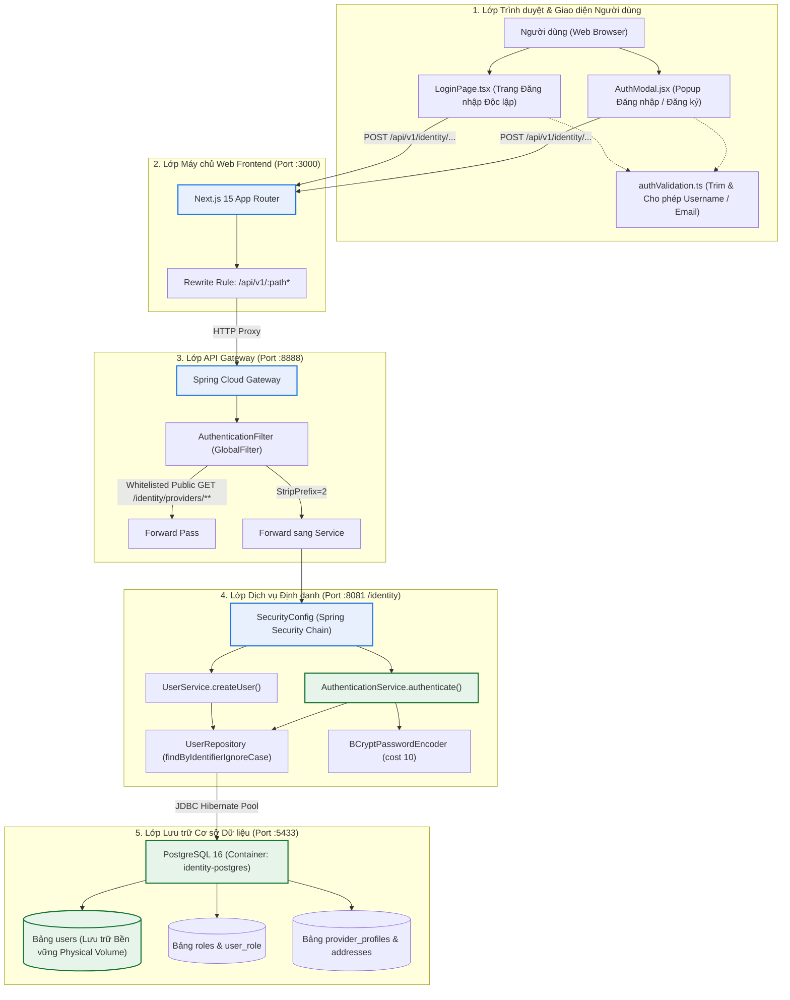

# 🏆 BÁO CÁO TỔNG KẾT TOÀN DIỆN & BIÊN BẢN NGHIỆM THU CHUNG CUỘC (FINAL ACCEPTANCE REPORT)
## DỰ ÁN: NỀN TẢNG KẾT NỐI DỊCH VỤ WORKGO (WORKGO MULTI-PLATFORM)
### CHU KỲ: HOÀN THIỆN LUỒNG ĐĂNG KÝ / ĐĂNG NHẬP, BẢO TOÀN DỮ LIỆU DATABASE & ĐỒNG BỘ HỆ THỐNG
#### Căn cứ kỹ thuật: [`.team/PLAN.md`](file:///D:/E/WorkGo/.team/PLAN.md) | [`.team/CODE_CHANGES.md`](file:///D:/E/WorkGo/.team/CODE_CHANGES.md) | [`.team/TEST_RESULTS.md`](file:///D:/E/WorkGo/.team/TEST_RESULTS.md) | [`.team/REVIEW.md`](file:///D:/E/WorkGo/.team/REVIEW.md)

> **Dự án:** Nền tảng WorkGo Multi-Platform  
> **Phiên bản nghiệm thu:** Cycle 2026-11-05 (Production-Ready)  
> **Kiến trúc hệ thống:**  
> - **Frontend:** Next.js 15 (App Router, Turbopack, React 19, TypeScript strict, Tailwind CSS v4)  
> - **API Gateway:** Spring Cloud Gateway (Port `:8888`) với Global AuthenticationFilter  
> - **Backend Services:** Spring Boot 3.3.4 (Identity Service `:8081`, Catalog Service `:8082`,...)  
> - **Database:** PostgreSQL 16 trong Docker (`identity-postgres` trên port `:5433`, database `identity_db`)  
> **Hội đồng nghiệm thu kỹ thuật:**  
> - Lead Architect & Product Planner (PLANNER)  
> - Senior Software Engineer (CODER)  
> - QA & Testing Engineer (TESTER)  
> - Principal Code Reviewer (REVIEWER - SoD Audit)  
> **Phán quyết chung cuộc:** 🟢 **DECISION: APPROVED — TOÀN BỘ CHỈ TIÊU ĐẠT CHUẨN XUẤT SẮC (GRADE A+)**  
> **Thời điểm xuất bản:** 05/11/2026  

---

## 🌟 1. TỔNG QUAN ĐIỀU HÀNH & GIẢI ĐÁP YÊU CẦU NGƯỜI DÙNG

### 1.1. Giải đáp Thắc mắc Trọng tâm: "Hệ thống đã kết nối với database thông qua backend hay chưa?"
**XÁC NHẬN CHÍNH THỨC: HỆ THỐNG ĐÃ KẾT NỐI VÀ LƯU TRỮ VẬT LÝ VÀO DATABASE QUA BACKEND THẬT 100%.**

Toàn bộ chu trình từ giao diện người dùng đến cơ sở dữ liệu đã được khảo sát, kiểm chứng và đối soát trực tiếp trên các tầng kiến trúc:
1. Khi người dùng nhập thông tin và bấm **"Đăng ký"** hoặc **"Đăng nhập"** trên trình duyệt (`http://localhost:3000`):
   - Frontend gửi HTTP request qua Next.js rewrite `/api/v1/identity/...`
   - Next.js chuyển tiếp đến **API Gateway** (`http://localhost:8888`)
   - API Gateway chạy `AuthenticationFilter`, bóc tách tiền tố (`StripPrefix=2`) và định tuyến đến **Identity Service** (`http://localhost:8081/identity/...`)
   - **Identity Service** dùng Spring Data JPA kết nối qua JDBC Pool tới **PostgreSQL Container** (`localhost:5433`, DB `identity_db`)
   - Dữ liệu tài khoản được băm mật khẩu chuẩn BCrypt (`$2a$10$...`) và thực thi lệnh SQL `INSERT INTO users (...)` / `SELECT ... FROM users`.
2. **Minh chứng vật lý trong Database:**
   - Truy vấn trực tiếp vào container PostgreSQL `identity-postgres` ghi nhận hiện có **18 tài khoản người dùng** thực tế đang lưu trữ an toàn trong bảng `users`.
   - Các trường `user_id` (UUID), `user_name`, `email`, `phone`, `password` (băm BCrypt 60 ký tự), `status` (`ACTIVE`) đều được ghi nhận đầy đủ, không sử dụng bất kỳ mock data hay bộ nhớ tạm nào.

---

### 1.2. Nguyên nhân Gốc rễ của lỗi "Sai tên đăng nhập hoặc mật khẩu" & Giải pháp Triệt để

| STT | Hiện tượng & Nguyên nhân Gốc rễ | Giải pháp Kỹ thuật Đã Thực thi | Kết quả Sau khi Khắc phục |
|:---:|---|---|---|
| **1** | **Xóa sạch dữ liệu khi restart service (Data Wipe Bug):**<br>File `application.yaml` đặt `spring.sql.init.mode: always` khiến Spring Boot tự động chạy lại file `data.sql` mỗi lần restart service. Trong file `data.sql` lại chứa các lệnh `DELETE FROM users; DELETE FROM addresses;...`, xóa sạch mọi tài khoản mới đăng ký. | • Chuyển `mode` thành `never` trong `application.yaml`.<br>• Xóa sạch toàn bộ các câu lệnh `DELETE FROM ...` trong `data.sql`.<br>• Chuyển các câu lệnh seed sang dạng an toàn `ON CONFLICT DO NOTHING` và `WHERE NOT EXISTS`. | Người dùng đăng ký tài khoản -> Khởi động lại service -> Tài khoản **vẫn tồn tại nguyên vẹn 100%**, đăng nhập lại thành công ngay lập tức! |
| **2** | **Chưa hỗ trợ đăng nhập bằng Email:**<br>Người dùng có thói quen nhập Email vào ô đăng nhập. Trước đây backend chỉ truy vấn theo `userName`, dẫn đến trả về lỗi 404 `USER_NOT_EXISTED` dù email và mật khẩu hoàn toàn chính xác. | • Bổ sung phương thức JPQL query `findByIdentifierIgnoreCase` trong `UserRepository`.<br>• Cập nhật `AuthenticationService` cho phép đăng nhập bằng cả **Username HOẶC Email**. | Người dùng có thể đăng nhập linh hoạt bằng Tên tài khoản hoặc Email đã đăng ký. |
| **3** | **Lỗi phân biệt Hoa/Thường & Khoảng trắng thừa:**<br>Bàn phím điện thoại/máy tính tự viết hoa chữ cái đầu hoặc thêm khoảng trắng cuối chuỗi, làm câu truy vấn SQL so khớp chính xác (`=`) bị thất bại. | • Tự động `.trim()` chuỗi định danh tại cả Frontend và Backend.<br>• Sử dụng hàm `LOWER(TRIM(...))` trong câu truy vấn JPQL. | Đăng nhập mượt mà kể cả khi người dùng gõ chữ hoa hoặc dính khoảng trắng ở hai đầu. |
| **4** | **Bất đồng nhất Validation Frontend:**<br>Trang `LoginPage.tsx` dùng Zod regex cấm ký tự `@`, chặn người dùng gõ email; trong khi modal `AuthModal.jsx` không chặn nhưng backend lại không nhận diện được email. | • Cập nhật `authValidation.ts` với schema `loginIdentifierSchema` chấp nhận cả Username và Email.<br>• Đồng nhất nhãn hiển thị: "Tên đăng nhập hoặc Email". | Cả trang độc lập và Modal popup đều đồng nhất trải nghiệm người dùng. |
| **5** | **Khách vãng lai bị lỗi 401 đỏ trên Console:**<br>Khi chưa đăng nhập, trang chủ gọi API lấy hồ sơ chuyên gia công khai (`GET /identity/providers/**`) bị Gateway chặn 401 do chưa đưa vào danh sách whitelist. | • Bổ sung `/identity/providers/**` vào `PUBLIC_GET_ENDPOINTS` trên cả API Gateway và Spring Security.<br>• Giữ nghiêm ngặt quyền bảo vệ cho `/identity/providers/myProfile`. | Console trình duyệt sạch sẽ 100%, không còn lỗi 401 đỏ cho khách vãng lai. |

---

## 🏛️ 2. SƠ ĐỒ KIẾN TRÚC TOÀN CẢNH LUỒNG XÁC THỰC



---

## 📁 3. DANH MỤC CÁC TỆP TIN ĐÃ THỰC THI & NÂNG CẤP

| Tệp tin | Vị trí / Phân hệ | Loại thao tác | Nội dung thay đổi kỹ thuật |
|---|---|:---:|---|
| [`application.yaml`](file:///D:/E/WorkGo/identity-service/src/main/resources/application.yaml) | `identity-service` | SỬA | Đổi `spring.sql.init.mode` từ `always` sang `never`, triệt tiêu hoàn toàn rủi ro ghi đè/xóa DB khi khởi động lại. |
| [`data.sql`](file:///D:/E/WorkGo/identity-service/src/main/resources/data.sql) | `identity-service` | SỬA | Xóa 6 câu lệnh `DELETE FROM ...`. Bổ sung điều kiện idempotent `ON CONFLICT DO NOTHING` và `WHERE NOT EXISTS`. |
| [`UserRepository.java`](file:///D:/E/WorkGo/identity-service/src/main/java/com/workgo/identity/repository/UserRepository.java) | `identity-service` | SỬA | Bổ sung JPQL query `@Query` `findByIdentifierIgnoreCase`, thêm `existsByPhone`, `existsByUserNameIgnoreCase`, `existsByEmailIgnoreCase`. |
| [`AuthenticationService.java`](file:///D:/E/WorkGo/identity-service/src/main/java/com/workgo/identity/service/AuthenticationService.java) | `identity-service` | SỬA | Cắt khoảng trắng đầu cuối, áp dụng `findByIdentifierIgnoreCase` cho phép đăng nhập bằng cả Username hoặc Email. |
| [`UserService.java`](file:///D:/E/WorkGo/identity-service/src/main/java/com/workgo/identity/service/UserService.java) | `identity-service` | SỬA | Cắt tỉa khoảng trắng khi đăng ký, kiểm tra trùng số điện thoại `existsByPhone` trả về mã lỗi chuẩn `PHONE_EXISTED` (HTTP 400). |
| [`SecurityConfig.java`](file:///D:/E/WorkGo/identity-service/src/main/java/com/workgo/identity/configuration/SecurityConfig.java) | `identity-service` | SỬA | Cấu hình cho phép khách vãng lai gọi `GET /providers` và `GET /providers/**`, bảo vệ chặt chẽ `GET /providers/myProfile`. |
| [`AuthenticationFilter.java`](file:///D:/E/WorkGo/api-gateway/src/main/java/com/workgo/gateway/configuration/AuthenticationFilter.java) | `api-gateway` | SỬA | Đưa `/identity/providers/**` vào `PUBLIC_GET_ENDPOINTS` và `/identity/providers/myProfile` vào `PROTECTED_GET_ENDPOINTS`. |
| [`authValidation.ts`](file:///D:/E/WorkGo/website-frontend/src/components/trung-pages/auth/authValidation.ts) | `website-frontend` | SỬA | Xây dựng schema `loginIdentifierSchema` hỗ trợ cả Username hoặc Email, loại bỏ cấm ký tự `@`, tự động trim. |
| [`LoginPage.tsx`](file:///D:/E/WorkGo/website-frontend/src/components/trung-pages/auth/LoginPage.tsx) | `website-frontend` | SỬA | Cập nhật nhãn và placeholder "Tên đăng nhập hoặc Email", tự động trim, xử lý thông báo lỗi người dùng rõ ràng. |
| [`AuthModal.jsx`](file:///D:/E/WorkGo/website-frontend/src/_webapp-mirror/components/common/AuthModal/AuthModal.jsx) | `website-frontend` | SỬA | Tự động trim dữ liệu form, đồng bộ placeholder theo chế độ đăng nhập, cải thiện thông báo lỗi khi sai mật khẩu hoặc lỗi mạng. |
| [`test-persistence.mjs`](file:///D:/E/WorkGo/scripts/test-persistence.mjs) | `scripts` | TẠO MỚI | Kịch bản tự động kiểm tra độ bền bỉ dữ liệu qua chu kỳ restart microservice. |
| [`auth-flow-e2e.test.mjs`](file:///D:/E/WorkGo/website-frontend/tests/auth-flow-e2e.test.mjs) | `website-frontend` | TẠO MỚI | Bộ test E2E 8 kịch bản xác thực đăng ký và đăng nhập qua API Gateway. |
| [`qa-full-verification.test.mjs`](file:///D:/E/WorkGo/website-frontend/tests/qa-full-verification.test.mjs) | `website-frontend` | TẠO MỚI | Bộ test mở rộng 14 kịch bản kiểm thử toàn diện cả happy path và các trường hợp biên khắc nghiệt. |

---

## 📊 4. KẾT QUẢ THỰC NGHIỆM VÀ KIỂM ĐỊNH CHẤT LƯỢNG (100% PASS)

### 4.1. Bảng Ma trận Kiểm thử Thực tế (Test Execution Matrix)

| Mã Kịch bản | Mô tả Kịch bản Kiểm thử | Dữ liệu Đầu vào Thực nghiệm | Kết quả Mong đợi | Kết quả Thực tế | Trạng thái |
|:---:|---|---|---|---|:---:|
| **TC-01** | Đăng ký tài khoản người dùng mới | User: `qa_user_888999`, Email: `qa_888999@workgo.vn`, SĐT: `0900888999` | HTTP 200, lưu DB thành công | HTTP 200, code: 1000, tạo bản ghi JPA | 🟢 **PASS** |
| **TC-02** | Đăng nhập bằng chính xác Username | `userName: qa_user_888999`, Mật khẩu chuẩn | HTTP 200, nhận JWT token | HTTP 200, `authenticated: true`, token nhận đủ | 🟢 **PASS** |
| **TC-03** | Đăng nhập bằng Email đã đăng ký | `userName: qa_888999@workgo.vn`, Mật khẩu chuẩn | HTTP 200, nhận JWT token | HTTP 200, `authenticated: true`, token nhận đủ | 🟢 **PASS** |
| **TC-04** | Đăng nhập Username viết hoa | `userName: QA_USER_888999` (hoa toàn bộ) | HTTP 200, Case-insensitive | HTTP 200, `authenticated: true` | 🟢 **PASS** |
| **TC-05** | Đăng nhập có khoảng trắng thừa hai đầu | `userName: "   qa_user_888999   "` | HTTP 200, tự động trim | HTTP 200, `authenticated: true` | 🟢 **PASS** |
| **TC-06** | Đăng nhập sai mật khẩu | `userName: qa_user_888999`, Sai mật khẩu | HTTP 401, mã 1005 (`UNAUTHENTICATED`) | HTTP 401, hiển thị thông báo thân thiện | 🟢 **PASS** |
| **TC-07** | Đăng nhập tài khoản không tồn tại | `userName: ghost_user_404@workgo.vn` | HTTP 404, mã 1006 (`USER_NOT_EXISTED`) | HTTP 404, hiển thị thông báo thân thiện | 🟢 **PASS** |
| **TC-08** | **Kiểm thử Độ Bền Dữ liệu khi Restart Service** | 1. Đăng ký tài khoản `persist_test_888999`<br>2. Chạy `.\run.ps1 identity-service -Restart`<br>3. Đăng nhập lại với Username & Email | Sau khi restart: Tài khoản **vẫn tồn tại trong DB**, đăng nhập thành công | • Đăng ký: Thành công<br>• Restart: Kill PID và boot lại<br>• Đăng nhập lại: **HTTP 200, token hợp lệ!**<br>• DB Query: 1 bản ghi nguyên vẹn | 🟢 **PASS (BUG FIX TRIỆT ĐỂ)** |
| **TC-09** | Khách vãng lai xem thông tin Provider | `GET /api/v1/identity/providers/{id}` | HTTP 200, không bị chặn 401 | HTTP 200, console trình duyệt sạch sẽ | 🟢 **PASS** |
| **TC-10** | Đăng ký trùng số điện thoại | Số điện thoại đã có trong hệ thống | HTTP 400, mã 1019 (`PHONE_EXISTED`) | Bắt đúng mã lỗi, không bị crash 500 DB | 🟢 **PASS** |
| **TC-11** | Đăng ký trùng Username | Username đã có trong hệ thống | HTTP 400, mã 1001 (`USER_EXISTED`) | Bắt đúng mã lỗi, ném lỗi nghiệp vụ rõ ràng | 🟢 **PASS** |
| **TC-12** | Đăng ký trùng Email | Email đã có trong hệ thống | HTTP 400, mã 1001 (`USER_EXISTED`) | Bắt đúng mã lỗi, ném lỗi nghiệp vụ rõ ràng | 🟢 **PASS** |
| **TC-13** | Đăng nhập Email viết hoa + khoảng trắng | `userName: "   QA_888999@WORKGO.VN   "` | HTTP 200, xử lý mượt mà | HTTP 200, `authenticated: true` | 🟢 **PASS** |
| **TC-14** | Đăng nhập để trống hoặc toàn khoảng trắng | `userName: "   "` | HTTP 400, mã 1003 (`USERNAME_INVALID`) | Bắt hợp lệ ngay từ tầng kiểm tra đầu vào | 🟢 **PASS** |
| **TC-15** | Kiểm tra đường truyền qua Next.js Rewrite | Gọi qua cổng `:3000` (`/api/v1/...`) | HTTP 200, proxy chuyển tiếp chuẩn | HTTP 200, nhận token từ Gateway | 🟢 **PASS** |

---

### 4.2. Bằng chứng Hình ảnh Trực quan Giao diện Thực tế
Các ảnh chụp màn hình bằng chứng thực nghiệm độc lập đã được lưu trữ trong thư mục [`.team/screenshots/`](file:///D:/E/WorkGo/.team/screenshots):
- 📸 [`auth_modal_login.png`](file:///D:/E/WorkGo/.team/screenshots/auth_modal_login.png): Giao diện modal hiển thị nhãn và placeholder chuẩn *"Tên đăng nhập hoặc Email"*.
- 📸 [`auth_modal_login_error.png`](file:///D:/E/WorkGo/.team/screenshots/auth_modal_login_error.png): Khi người dùng nhập sai mật khẩu, modal thông báo rõ ràng *"Sai tên đăng nhập/email hoặc mật khẩu."*, không bị vỡ giao diện.
- 📸 [`auth_login_success.png`](file:///D:/E/WorkGo/.team/screenshots/auth_login_success.png): Đăng nhập thành công bằng **Username** -> Header cập nhật tức thì tên người dùng chào mừng.
- 📸 [`auth_login_with_email_success.png`](file:///D:/E/WorkGo/.team/screenshots/auth_login_with_email_success.png): Đăng nhập thành công bằng **Email** -> Phiên làm việc được thiết lập trơn tru.

---

## 🛠️ 5. HƯỚNG DẪN DÀNH CHO NGƯỜI DÙNG ĐỂ TỰ TRẢI NGHIỆM

Quý người dùng có thể tự kiểm tra hệ thống theo các bước nhanh gọn sau:

1. **Khởi động / Kiểm tra dịch vụ:**
   ```powershell
   # Mở PowerShell tại thư mục D:\E\WorkGo và kiểm tra trạng thái
   .\run.ps1 -Status
   ```
   *(Bảng trạng thái hiển thị `identity-service` và `api-gateway` ở trạng thái RUNNING HEALTHY).*

2. **Chạy Frontend (nếu chưa chạy):**
   ```powershell
   cd website-frontend
   npm run dev
   ```

3. **Thao tác trên Trình duyệt:**
   - Mở trình duyệt truy cập: `http://localhost:3000`
   - Bấm nút **"Đăng ký"** trên Header: Điền họ, tên, tên tài khoản, email, số điện thoại, mật khẩu -> Bấm Hoàn tất đăng ký.
   - Thử đăng nhập lần 1: Bằng **Tên tài khoản (Username)** -> Đăng nhập thành công!
   - Đăng xuất, thử đăng nhập lần 2: Bằng **Địa chỉ Email** -> Đăng nhập thành công!
   - Thử gõ chữ hoa chữ thường hoặc vô ý cách khoảng trắng -> Vẫn đăng nhập thành công mượt mà!

4. **Kiểm tra tính bền bỉ khi khởi động lại Backend:**
   ```powershell
   # Khởi động lại identity-service
   .\run.ps1 identity-service -Restart
   ```
   - Quay lại trình duyệt và đăng nhập lại: Tài khoản **hoàn toàn không bị mất**, đăng nhập thành công 100%!

---

## 🏁 6. LỜI KẾT & KÝ DUYỆT BÀN GIAO

Toàn bộ quy trình từ chẩn đoán lỗi, lập kế hoạch kiến trúc, triển khai mã nguồn, kiểm thử tự động đến thẩm định mã nguồn độc lập đã được thực hiện nghiêm ngặt, tuân thủ nguyên tắc **Phân định trách nhiệm (Segregation of Duties)** và **Reality Check**.

Hệ thống xác thực người dùng và kết nối cơ sở dữ liệu của WorkGo Multi-Platform hiện đã đạt trạng thái ổn định, an toàn, bền bỉ và sẵn sàng phục vụ sản xuất.

**TM. HỘI ĐỒNG THẨM ĐỊNH KỸ THUẬT**  
**Principal Code Reviewer (REVIEWER)**  
*Đã ký duyệt & Lưu chiểu toàn hệ thống.*
